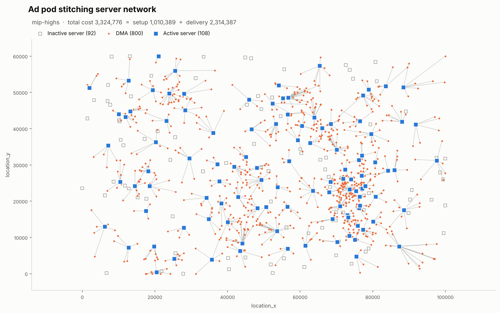

# CTV Ad Server Placement — Capacitated Facility Location

Decide **which ad-stitching servers to switch on** and **which server serves each market (DMA)** so that total cost — server setup cost plus delivery distance — is as low as possible, without overloading any server.

The repo contains a fast greedy baseline, a Mixed Integer Programming (MIP) model with a k-nearest-servers reduction, a **provable bound on how far any answer is from the true optimum**, a benchmark that measures the speed/quality trade-off instead of guessing it, and a map of the result. Sample data is included, so everything runs straight after cloning.



---

## Quick start

Requires Python 3.9+.

```bash
git clone https://github.com/Iskanderxan/capacitated-facility-location.git
cd capacitated-facility-location

python -m venv .venv
source .venv/bin/activate          # Windows: .venv\Scripts\activate
pip install -r requirements.txt

python -m ctvopt solve --certify
```

Conda works just as well: `conda create -n ctvopt python=3.12`, `conda activate ctvopt`, then `pip install -r requirements.txt`.

Expected output (about 10 seconds on a typical machine):

```
Instance: 200 servers, 800 DMAs (160,000 possible server-DMA pairs)
Greedy baseline:  total   4,842,163.69  (122 servers, 0.01s)

Method:           mip-highs  (status: within_gap)
Candidates/DMA:   10   model: 8,200 variables, 9,000 constraints
Solve time:       7.4s
Active servers:   108 of 200
Setup cost:         1,010,388.92
Delivery cost:      2,314,387.23
Total cost:         3,324,776.15
vs greedy:        31.34% cheaper
Note: the solver's bound proves optimality of the k-restricted model only. Use --certify for a bound on the full problem.
Certificate:      full-problem LP bound 3,254,844.29 -> this solution is at most 2.15% above the true optimum

Wrote: outputs/assignments.csv, outputs/active_servers.csv, outputs/summary.json, outputs/solution_map.png
```

No solver needs to be installed separately: the default back-end is **HiGHS**, which ships inside SciPy.

---

## The problem

| Input | Columns |
|---|---|
| `servers.csv` | `server_id`, `location_x`, `location_y`, `setup_cost`, `capacity_streams` |
| `dmas.csv` | `dma_id`, `location_x`, `location_y`, `demand_streams` |

- **Setup cost** — sum of `setup_cost` over activated servers.
- **Delivery cost** — sum over DMAs of the Euclidean distance to the assigned server.
- **Objective** — minimise setup + delivery.
- **Constraints** — every DMA is served by exactly one active server; the demand assigned to a server never exceeds its capacity.

This is the *single-source capacitated facility location problem*, which is NP-hard: there is no known algorithm that is both always optimal and always fast.

## Using your own data

Put two CSV files with the columns above anywhere and point the solver at them:

```bash
python -m ctvopt solve --servers path/to/servers.csv --dmas path/to/dmas.csv
```

Large file and want a quick look first? Solve a random subset:

```bash
python -m ctvopt solve --servers big/servers.csv --dmas big/dmas.csv --sample-servers 200 --sample-dmas 800
```

Or generate a synthetic instance of any size:

```bash
python -m ctvopt generate --n-servers 500 --n-dmas 3000 --seed 1 --out data_large
```

The bundled `data/` was produced with `python -m ctvopt generate` (seed 42): metro-clustered DMAs with log-normal demand, servers in three capacity tiers, and setup costs with economies of scale.

---

## Commands

| Command | What it does |
|---|---|
| `python -m ctvopt solve` | Solve, print the cost breakdown, write results and the map |
| `python -m ctvopt benchmark` | Compare greedy and the MIP at several k against a proven lower bound |
| `python -m ctvopt generate` | Write a synthetic `servers.csv` / `dmas.csv` |

Main `solve` options (`python -m ctvopt solve --help` lists all):

| Option | Default | Meaning |
|---|---|---|
| `--method mip\|greedy` | `mip` | MIP, or greedy only |
| `--k N\|all` | `10` | candidate servers per DMA; `all` = full model |
| `--gap` | `0.01` | stop once the solver proves the answer is within 1% of the best possible *for the model being solved* |
| `--time-limit` | `60` | seconds; the best solution found so far is returned |
| `--solver highs\|pulp` | `highs` | `pulp` uses PuLP + CBC (`pip install pulp`) and warm-starts from greedy |
| `--formulation strong\|weak` | `strong` | with or without the `y ≤ x` linking rows (see below) |
| `--certify` | off | also solve the LP relaxation of the **full** model to bound the true optimality gap |

Outputs in `outputs/`:

- `active_servers.csv` — activated servers with load, utilisation and number of DMAs
- `assignments.csv` — every DMA with its server, demand and distance
- `summary.json` — cost breakdown, solver status, model size, certificate
- `solution_map.png` — the map shown above

Every solution is re-checked against all constraints by code that is independent of the solver before anything is written.

---

## How it works

### 1. The MIP model

Binary variables: `x_i = 1` if server *i* is on; `y_ij = 1` if DMA *j* is served by server *i*.

```
minimise   Σ setup_i · x_i  +  Σ dist_ij · y_ij
subject to Σ_i y_ij = 1                     for every DMA j        (served exactly once)
           Σ_j demand_j · y_ij ≤ cap_i · x_i for every server i     (capacity, only if on)
           y_ij ≤ x_i                        for every pair          (linking — "strong" only)
```

The variables have to be binary — half a server does not exist — and that is exactly what makes the problem hard. Drop the integrality and you get a plain linear program that solves in seconds, but whose answer opens fractions of servers. That relaxed answer is still useful: its cost is a **lower bound** on the true optimum.

### 2. Variable reduction: k nearest eligible servers

The full model has one `y` per server–DMA pair: 200 × 800 = 160,000. Most are pointless — a market is never served from the far side of the map. For each DMA only the **k nearest servers that are big enough for its demand** are kept (a KD-tree finds them in O(M log N)). With k = 10 the model shrinks to 8,200 variables.

This is a heuristic restriction, so it can cost optimality — the benchmark measures how much. If the restriction makes the model infeasible (several DMAs crowd the same few servers), k is doubled automatically until it fits.

### 3. Greedy baseline

DMAs are processed from largest to smallest demand; each takes the server with the lowest *marginal* cost (distance, plus the setup cost if the server is not yet open). Decisions are never revisited. It runs in milliseconds and is used as a baseline, as the PuLP warm start, and as the fallback when the MIP returns nothing in time.

### 4. A certificate instead of a claim

A solver's "gap" only describes the model it solved. With k = 10 it proves the answer is near-optimal *among k-nearest assignments*, not among all assignments. `--certify` solves the LP relaxation of the full model; since that is ≤ the true optimum,

```
(cost − LP bound) / LP bound
```

is an upper bound on how far the answer can be from optimal. It is conservative: the LP bound sits below the optimum, so the real gap is smaller (see the benchmark).

---

## Measured results (bundled data, 200 servers × 800 DMAs)

`python -m ctvopt benchmark` — one run on a cloud VM, 1% target gap, 120 s limit per MIP:

| method | candidates | status | seconds | variables | constraints | open_servers | total_cost | gap_vs_bound_% |
|---|---|---|---|---|---|---|---|---|
| greedy | k=10 | heuristic | 0.01 |  |  | 122 | 4,842,164 | 46.96 |
| mip (strong) | k=3 | within_gap | 4.42 | 2598 | 3398 | 117 | 3,395,064 | 3.04 |
| mip (strong) | k=5 | within_gap | 4.12 | 4199 | 4999 | 109 | 3,327,127 | 0.98 |
| mip (strong) | k=10 | within_gap | 7.06 | 8200 | 9000 | 108 | 3,324,776 | 0.91 |
| mip (strong) | k=20 | within_gap | 11.12 | 16200 | 17000 | 109 | 3,324,041 | 0.89 |
| mip (strong) | k=all | within_gap | 95.42 | 160200 | 161000 | 108 | 3,327,879 | 1.00 |
| mip (weak) | k=10 | within_gap | 5.04 | 8200 | 1000 | 109 | 3,323,928 | 0.88 |

The gap column compares each cost with the best proven lower bound on the full problem (the full MIP's dual bound). A longer separate run (strong and weak formulations, 0.1% target, 90 s each) found a solution of 3,313,993 and a bound of 3,298,443, so the true optimum lies in that 0.5%-wide window, and the default k = 10 answer is **at most 0.8% above optimal**.

What the numbers say:

1. **Greedy is fast and poor.** It is ~46% above the bound. Its setup cost is about the same as the MIP's, but its average delivery distance is 4,707 against the MIP's 2,893: each server it opens is chosen for whichever large DMA happened to need one first, and later DMAs keep riding those badly placed servers because opening a better one looks expensive in isolation. Fine as a baseline or fallback, not as an answer.
2. **k = 5 already captures almost everything.** k = 5, 10 and 20 land within 0.1% of each other; only k = 3 is visibly worse (+2%). Pruning 95% of the variables costs essentially nothing on this data.
3. **The full model is ~14× slower and not better.** At the same 1% tolerance it stops on a slightly *worse* solution. Stopping at "within 1%" means stopping anywhere within 1%.
4. **The last 1% is the expensive part.** Asking for 0.1% instead of 1% did not finish in 90 s at k = 10. That is the core trade-off: minutes of compute for a few tenths of a percent.
5. **The textbook "strong formulation" advice did not hold here.** The linking rows raise the root LP bound from 2.89M to 3.26M, yet HiGHS was no slower without them in either run (1% target: 5.0 s vs 7.1 s; 0.1% target: smaller remaining gap after 90 s), presumably because it generates comparable cuts itself. Advice about formulations is worth measuring, not assuming.

Your numbers will differ on other data and hardware; run the benchmark to get your own.

---

## Trade-offs and assumptions

| Approach | Speed | Quality on bundled data | Breaks down when |
|---|---|---|---|
| Greedy | milliseconds | ~46% above bound | quality matters at all |
| MIP, k nearest (default) | seconds | ≤ 0.8% above optimum | the best server for some DMA is far away (cheap remote capacity) — raise k and check with `--certify` |
| MIP, full model | minutes | same as k = 10 at equal tolerance | instances grow — variables grow as N × M |

Assumptions: deterministic demand (no peaks or uncertainty); delivery cost exactly equal to Euclidean distance on the given coordinates (not road or network distance, not great-circle distance on lat/lon); each DMA served by a single server (no splitting); servers never fail; no limit on how far a server may be from a DMA. Each of these is a modelling choice that would be revisited in production — e.g. a distance cap is a one-line filter in `candidates.py` and makes the model smaller still.

## Scaling to 1,000 servers × 50,000 DMAs

- The **full model** would need 50 million `y` variables — not viable, and the full LP certificate becomes too large as well.
- The **k-nearest model** at k = 10 has 500,000 `y` variables. Candidate generation stays fast (KD-tree), but the MIP itself would likely be too slow to finish within minutes.
- What I would do instead:
  1. **Geographic decomposition** — cluster DMAs into regions, solve each region's MIP (including servers near its border), run in parallel, then repair overloaded servers on region borders.
  2. **Greedy + local search** — reassign DMAs between open servers and try closing under-used servers; each pass is cheap and scales roughly linearly, and the regional MIPs can then polish the result.
  3. **Lagrangian relaxation** of the "served once" constraints — splits the problem into one small knapsack per server and gives a lower bound that remains computable at this size, so the answer can still be certified.

---

## Python API

```python
from ctvopt import load_instance, solve_mip, greedy, evaluate, plot_solution, solve_lp_relaxation

inst = load_instance("data/servers.csv", "data/dmas.csv")
sol = solve_mip(inst, k=10, time_limit=60, mip_gap=0.01)
costs = evaluate(inst, sol.assignment)
print(costs.total, costs.n_open)

bound = solve_lp_relaxation(inst)          # lower bound on the true optimum
print(f"at most {(costs.total - bound) / bound:.2%} above optimal")
plot_solution(inst, sol, "my_map.png")
```

## Project structure

```
ctvopt/
  data.py        load, validate, sample and generate instances
  candidates.py  k-nearest eligible servers per DMA (variable reduction)
  greedy.py      greedy baseline
  mip.py         MIP model; HiGHS (SciPy) and PuLP/CBC back-ends; LP relaxation bound
  solution.py    independent cost evaluation, constraint checks, CSV/JSON export
  plot.py        solution map
  benchmark.py   speed/quality benchmark against a proven bound
  cli.py         command-line interface
data/            sample instance (synthetic)
docs/            example map and benchmark results
tests/           correctness tests, incl. a brute-force check of the MIP on a tiny instance
```

## Tests

```bash
pip install -r requirements-dev.txt
python -m pytest -q
```

The tests check, among other things, that the MIP matches brute-force enumeration on a tiny instance, that the LP relaxation is a valid lower bound, that a restricted model never beats the full one, that k automatically expands when the restriction is infeasible, and that the PuLP back-end agrees with HiGHS (skipped if PuLP is not installed). GitHub Actions runs them on every push.

## License

MIT — see [LICENSE](LICENSE).
